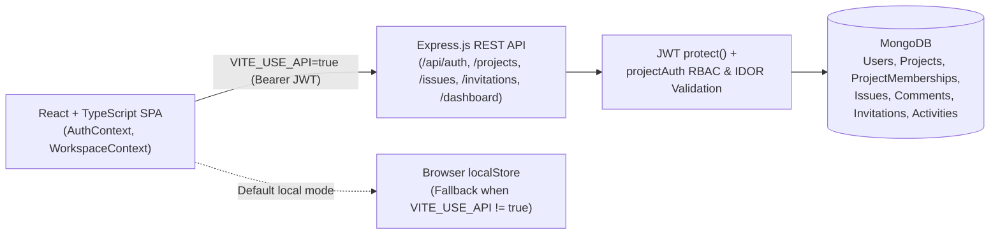

# Trackly – Bug & Issue Tracker

Trackly is a full-stack, multi-user bug and issue tracking application built with React, TypeScript, Express.js, and MongoDB. It replaces fragmented spreadsheets and chat threads with a centralized workspace where teams organize projects, triage issues, collaborate through comments and attachments, and track progress across workflow stages. Accounts and projects are strictly isolated by default, with access granted only through explicit invitation acceptance and project-scoped Role-Based Access Control (RBAC).

---

## Live Demo

- **Live Application:** `[INSERT MY ACTUAL RENDER URL HERE]`
- **GitHub Repository:** [https://github.com/Akarsh-ui/Trackly-Bug-Issue-Tracker](https://github.com/Akarsh-ui/Trackly-Bug-Issue-Tracker)

---

## Table of Contents

- [Key Features](#key-features)
- [Technology Stack](#technology-stack)
- [Application Workflow](#application-workflow)
- [Use Cases](#use-cases)
- [Research Work](#research-work)
- [System Architecture and Security](#system-architecture-and-security)
- [User Roles and Permissions](#user-roles-and-permissions)
- [Installation and Local Setup](#installation-and-local-setup)
- [Available Scripts](#available-scripts)
- [Testing](#testing)
- [Deployment](#deployment)
- [Future Enhancements](#future-enhancements)
- [Conclusion](#conclusion)
- [Author](#author)

---

## Key Features

- **Authentication & Preferences:** Registration, login, profile and password management, light/dark themes, and table density settings backed by `bcryptjs` hashing and JWT sessions.
- **Account & Project Isolation:** New accounts start with zero projects and cannot view or modify another user's projects, issues, comments, activities, or invitations.
- **Project Management:** Create and configure projects with unique keys (auto-incrementing keys such as `PAY-1`), leads, progress metrics, and member controls.
- **Issue Tracking & Categories:** Full CRUD with `Low`, `Medium`, `High`, and `Urgent` priorities, labels, due dates, file attachments (up to 10 MB), optional bug/feature fields, and 10 issue types: `Bug`, `Feature Request`, `Task`, `Improvement`, `UI/UX`, `Performance`, `Security`, `Documentation`, `Research / Spike`, and `Maintenance`.
- **Kanban Workflow:** Drag-and-drop board across `To Do`, `In Progress`, and `Done` using `@dnd-kit`, with read-only locking for Viewers.
- **Search, Filtering & Sorting:** Query issues by project, type, status, priority, assignee, or keyword, and sort by date, priority weight, due date, or last update.
- **Comments & Activity Logs:** Create, edit, and delete issue comments alongside chronological project and issue activity timelines.
- **Invitation Lifecycle:** Shareable SHA-256-hashed, 7-day invitation links (`Pending`, `Accepted`, `Rejected`, `Expired`, `Revoked`) with recipient email validation and an in-app **Invitations** inbox.
- **Project-Scoped RBAC:** Per-project `Owner`, `Admin`, `Member`, and `Viewer` permissions enforced on both API routes and UI controls.

---

## Technology Stack

| Technology | Purpose in Trackly |
|---|---|
| React 19 & TypeScript | Builds a modular, type-safe single-page interface across pages, drawers, and modals. |
| Vite 8 | Powers local dev bundling and optimized production static asset builds. |
| Tailwind CSS 4 | Provides utility-first styling across Warm Paper light and Studio Charcoal dark themes. |
| React Router 7 | Handles client-side routing, protected views, and invite links (`/invite/:token`). |
| `@dnd-kit` | Enables accessible drag-and-drop issue movement across Kanban workflow columns. |
| Recharts | Renders priority and issue-type breakdown charts on the dashboard. |
| React Hook Form & Motion | Manages validated form submissions and subtle authentication view transitions. |
| Lucide React & React Hot Toast | Supplies UI iconography and non-blocking action notifications. |
| Node.js & Express.js | Serves the REST API, file uploads, and static production frontend bundle. |
| MongoDB & Mongoose | Persists users, projects, memberships, issues, comments, invitations, and activities. |
| `jsonwebtoken` & `bcryptjs` | Signs stateless JWT session tokens and salts/hashes account passwords. |
| Helmet, CORS & Multer | Configures security headers, origin rules, and multipart attachment uploads. |

---

## Application Workflow

No genuine screenshots of the running Trackly interface are stored in the repository yet (no `screenshots/` assets exist). The core implemented workflow follows this sequence:

1. **Registration and Login** (`/login`, `/register`): Two-column auth view with field validation, password strength meter, and invite redirect handling. *(Target path: `screenshots/login.png`, `screenshots/register.png`)*
2. **Dashboard** (`/`): Summarizes KPI counts, Recharts priority/type charts, assigned and overdue issues, project completion bars, recent activity, and a Pending Project Invitations banner. *(Target path: `screenshots/dashboard.png`)*
3. **Projects & Project Details** (`/projects`, `/projects/:id`): Searchable project table and tabbed workspace (`Overview`, `Issues`, `Kanban Board`, `Activity`, `Settings`). *(Target path: `screenshots/projects.png`, `screenshots/project-details.png`)*
4. **Issue Management** (`/issues`, `/issues/:id`): Filterable table/list view, quick-view drawer and full issue page, metadata selectors, attachments, comments, and activity history. *(Target path: `screenshots/issues.png`, `screenshots/issue-details.png`)*
5. **Kanban Board** (`/board`): Three-column board (`To Do`, `In Progress`, `Done`) with drag-and-drop status updates and project/priority filters. *(Target path: `screenshots/kanban-board.png`)*
6. **Team Collaboration** (`/team`): Collaborator directory showing per-project roles plus an invitation management table for `Owner` and `Admin` users. *(Target path: `screenshots/team-members.png`)*
7. **Invitations** (`/invitations`, `/invite/:token`): Dedicated inbox and token validation page where recipients explicitly **Accept** or **Reject** invitations before gaining project access. *(Target path: `screenshots/invitations.png`, `screenshots/accept-invitation.png`)*
8. **Role-Based Access**: UI actions in member lists, settings, drawers, and boards adapt dynamically to the user's `Owner`, `Admin`, `Member`, or `Viewer` role.

---

## Use Cases

- **Developers:** Organize product areas into keyed projects and work through assigned tasks, bugs, and improvements.
- **Testers & QA:** Report bugs with reproduction steps, expected vs. actual outcomes, environment details, and file attachments.
- **Engineering Teams:** Monitor delivery flow across `To Do`, `In Progress`, and `Done` on the Kanban board.
- **Project Owners:** Create projects, manage `Admin` roles, configure settings, and delete owned projects.
- **Administrators:** Invite collaborators as `Member` or `Viewer`, update non-admin roles, and moderate issues/comments.
- **Members:** Create and triage issues, upload attachments, comment on threads, and delete their own records.
- **Viewers:** Inspect dashboards, issues, boards, and activity timelines with strict read-only protection.

---

## Research Work

### Problem Research

Ad-hoc bug tracking across spreadsheets and chat channels causes lost reproduction details, ambiguous ownership, and poor visibility into blockers. A centralized issue tracker solves this by enforcing structured issue metadata, unique keys, clear assignment, and auditable status transitions.

### Existing Platform Research

| Capability | Trackly | Jira | GitHub Issues | Linear | Trello |
|---|---|---|---|---|---|
| Project workspaces & sequential keys | Yes | Yes | Repo-scoped | Team-scoped | Board-scoped |
| Kanban workflow (`To Do` / `In Progress` / `Done`) | Yes | Yes | Projects v2 | Yes | Yes |
| Structured bug/feature fields | Yes | Custom fields | Issue forms | Templates | Limited |
| Project-scoped RBAC (`Owner`/`Admin`/`Member`/`Viewer`) | Yes | Custom schemes | Repo roles | Team/workspace | Board roles |
| Explicit invitation accept/reject inbox | Yes | Email/org invite | Repo invite | Email invite | Board invite |
| Sprints, CI/CD & custom workflows | Not implemented | Yes | Actions/PRs | Cycles/Git sync | Power-Ups |

### Technical Research

Trackly pairs a React + TypeScript SPA with an Express.js REST API and Mongoose schemas. Modeling access through a dedicated `ProjectMembership` collection (rather than a single global `User.role` or array-only checks) allows a user to hold distinct roles per project, prevents cross-project privilege leakage, and retains `'Removed'` status boundaries. When `MONGODB_URI` and `VITE_USE_API` are unset, a client-side `localStore` mirrors the same isolation and RBAC rules for local evaluation.

### Security Research

- **Credential Protection:** Passwords are strength-checked, salted/hashed with `bcryptjs`, hidden from default queries (`select: false`), and exchanged for signed JWTs (`Authorization: Bearer <token>`).
- **IDOR & Access Control:** Backend middleware (`protect`) and `projectAuth` helpers validate ObjectIds (`400`) and enforce active `ProjectMembership` capabilities (`403`) on every project, issue, comment, attachment, dashboard, and activity route.
- **Invitation Hardening:** Raw 32-byte tokens are never persisted; only SHA-256 hashes are stored with a 7-day TTL, recipient email checks (`403`), duplicate `Pending` conflict blocks (`409`), and zero auto-membership during registration.

### Research References

- React: [https://react.dev/](https://react.dev/)
- TypeScript: [https://www.typescriptlang.org/docs/](https://www.typescriptlang.org/docs/)
- Express.js: [https://expressjs.com/](https://expressjs.com/)
- MongoDB: [https://www.mongodb.com/docs/](https://www.mongodb.com/docs/)
- Mongoose: [https://mongoosejs.com/docs/](https://mongoosejs.com/docs/)
- OWASP: [https://owasp.org/](https://owasp.org/)
- OWASP Authorization Cheat Sheet: [https://cheatsheetseries.owasp.org/cheatsheets/Authorization_Cheat_Sheet.html](https://cheatsheetseries.owasp.org/cheatsheets/Authorization_Cheat_Sheet.html)
- JWT RFC 7519: [https://www.rfc-editor.org/rfc/rfc7519](https://www.rfc-editor.org/rfc/rfc7519)

---

## System Architecture and Security



- **Isolation & Session Reset:** `WorkspaceContext` clears cached projects, members, pending invitations, and active drawers whenever the authenticated user changes or logs out.
- **Membership-First Authorization:** Every data query scopes results to projects where the user holds an `'Active'` `ProjectMembership`; invited users gain access only after explicitly accepting the invitation.

---

## User Roles and Permissions

| Role | Access |
|---|---|
| `Owner` | Full project control: edit project settings, manage all member roles (including `Admin`), send/revoke invites, delete any issue/comment, and delete the project. |
| `Admin` | Project and team management within assigned permissions: edit project details/lead, invite/manage `Member` and `Viewer` users, and delete any issue/comment; cannot promote/remove `Admin`s or delete the project. |
| `Member` | Issue management and collaboration within assigned permissions: create/edit issues, upload attachments, post/edit comments, and delete only self-reported issues or self-authored comments. |
| `Viewer` | Read-only access: inspect project metrics, issues, Kanban board, comments, and activity logs; blocked (`403`) from all create, edit, move, upload, comment, or delete actions. |

---

## Installation and Local Setup

### Prerequisites

- **Node.js** (v18+ recommended) and **npm**
- **MongoDB Atlas** URI (or local MongoDB) for backend API persistence

### Setup Steps

```bash
git clone https://github.com/Akarsh-ui/Trackly-Bug-Issue-Tracker.git
cd Trackly-Bug-Issue-Tracker
npm install
```

Create a private local `.env` file from `.env.example` (never commit `.env` to GitHub), then start the app and open `http://localhost:3000`:

```bash
npm run dev
```

### Environment Configuration

Configure these variables in your private `.env` file without committing real values:

| Variable Name | Purpose |
|---|---|
| `MONGODB_URI` | MongoDB Atlas (or local MongoDB) connection string; when unset, `/api/*` data endpoints return `503`. |
| `JWT_SECRET` | Private key for signing JWT tokens (set a strong random secret such as `YOUR_LOCAL_SECRET` locally—not a real credential). |
| `JWT_EXPIRES_IN` | Optional JWT lifetime override (defaults to `7d`). |
| `PORT` | Optional server port (defaults to `3000`). |
| `NODE_ENV` | `development` (mounts Vite middleware) or `production` (serves `dist/`). |
| `FRONTEND_URL` | Optional deployed frontend origin for CORS and backend invite URL generation. |
| `VITE_USE_API` | `"true"` connects the frontend to the Express + MongoDB API; `"false"` uses browser `localStorage`. |
| `VITE_APP_URL` | Optional deployed frontend base URL for shareable `/invite/:token` links. |

---

## Available Scripts

| Command | Purpose |
|---|---|
| `npm run dev` | Start the Express + Vite development server (`tsx server.ts`). |
| `npm run build` | Build the production React bundle into `dist/` (`vite build`). |
| `npm run start` | Run the production Express server (`node server.ts`). |
| `npm run preview` | Preview the built production frontend (`vite preview`). |
| `npm run lint` | Run TypeScript type checking (`tsc --noEmit`). |
| `npm run clean` | Remove build output (`rm -rf dist server.js`). |

---

## Testing

Verification was performed locally against the codebase (no permanent test runner script is committed in `package.json`):

- **12-Scenario HTTP Integration Suite (`mongodb-memory-server`):** Tested directly against Express routes (`server/app.ts`) using an in-memory MongoDB instance (not a live MongoDB Atlas cluster):
  - Independent registration isolation (`0` initial projects, zero cross-account leakage across projects, issues, dashboard, activities, and users).
  - IDOR and validation enforcement (`403` on unauthorized project/issue/`issueKey`/comment/attachment access; `400` on invalid ObjectIds).
  - Invitation lifecycle: `'Pending'` state across registration/login, explicit acceptance and `'Rejected'` state persistence, `403` email mismatch, `410` expired/revoked links, and `409` duplicate pending invites.
  - RBAC across `Owner`, `Admin`, `Member`, and `Viewer`, immediate `403` access revocation upon member removal, `401` invalid JWT handling, and persistence across server/Mongoose restarts.
- **Local Store Parity:** Verified `localStore` registration isolation, explicit invite accept/reject, and `Viewer` write blocks.
- **Build & Type Check:** `npm run build` and `npm run lint` (`tsc --noEmit`) passed with zero errors; `/api/health` returned `{ ok: true }` locally (`databaseConfigured: false`).

---

## Deployment

Trackly is configured for unified deployment on **Render** with **MongoDB Atlas**:

- **Live Demo:** `[INSERT MY ACTUAL RENDER URL HERE]`
- **Build Command:** `npm install && npm run build`
- **Start Command:** `npm run start` (runs `node server.ts` with `NODE_ENV=production` to serve `dist/` and `/api/*`)
- **Production Variables (configured privately in Render):** `NODE_ENV=production`, `MONGODB_URI`, `JWT_SECRET`, `VITE_USE_API=true`, `FRONTEND_URL`, and `VITE_APP_URL`.

---

## Future Enhancements

- **Email Notifications:** Add SMTP/transactional email delivery for project invitations and issue updates.
- **Real-Time Collaboration:** Add WebSockets for live Kanban board moves and comment updates.
- **Sprint Planning:** Introduce time-boxed milestones and velocity/burndown charts.
- **Issue Export & SSO:** Support CSV/JSON exports and OAuth 2.0 sign-in.

---

## Conclusion

Trackly brings structured issue triage, Kanban tracking, and team collaboration together under strict account isolation, explicit invitation workflows, and project-scoped RBAC. The project demonstrates practical full-stack TypeScript, React, Express.js, and MongoDB engineering with verified server-side authorization controls.

---

## Author

**Akarsh Saini**  
GitHub: [https://github.com/Akarsh-ui](https://github.com/Akarsh-ui)
